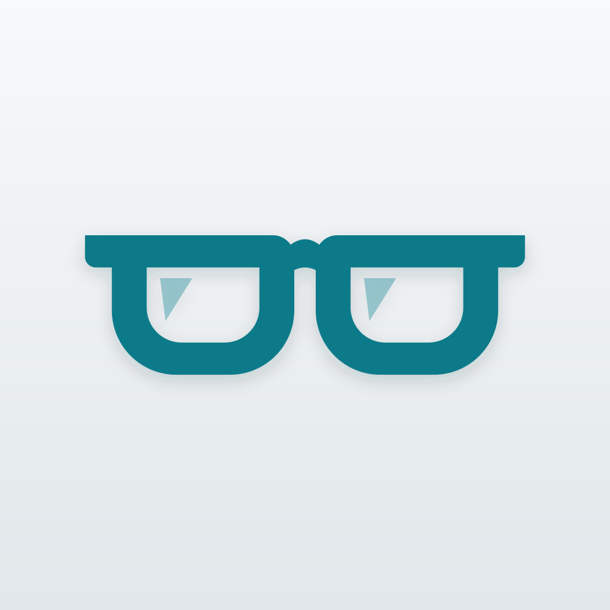
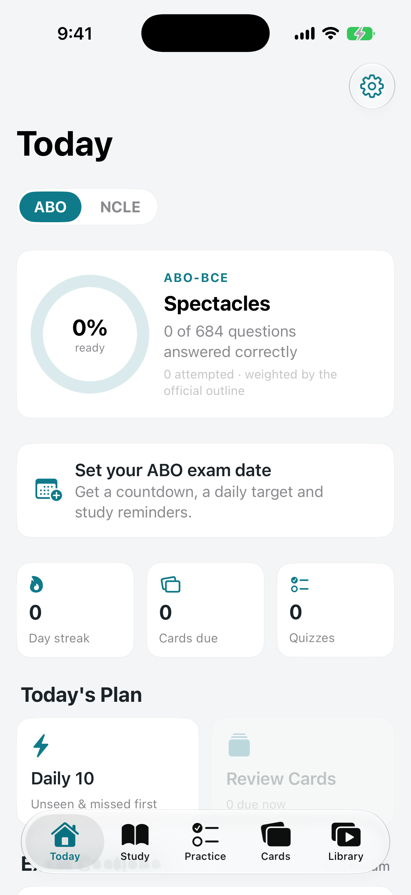
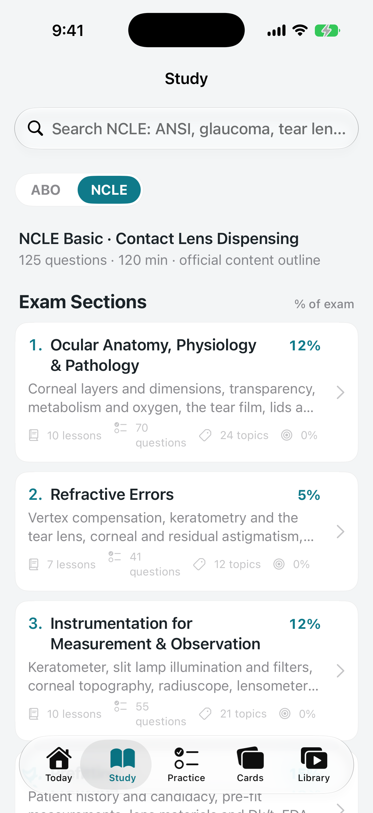
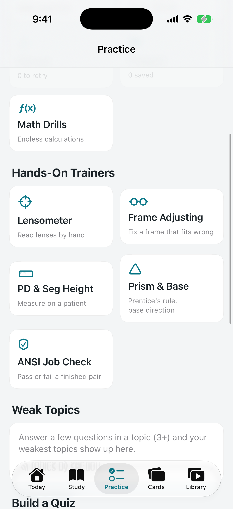
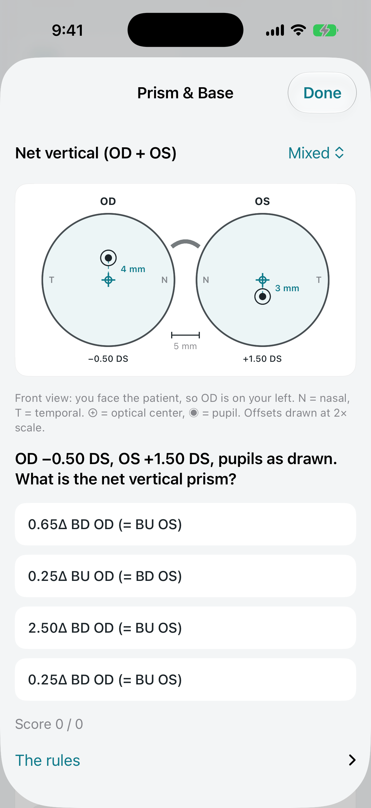
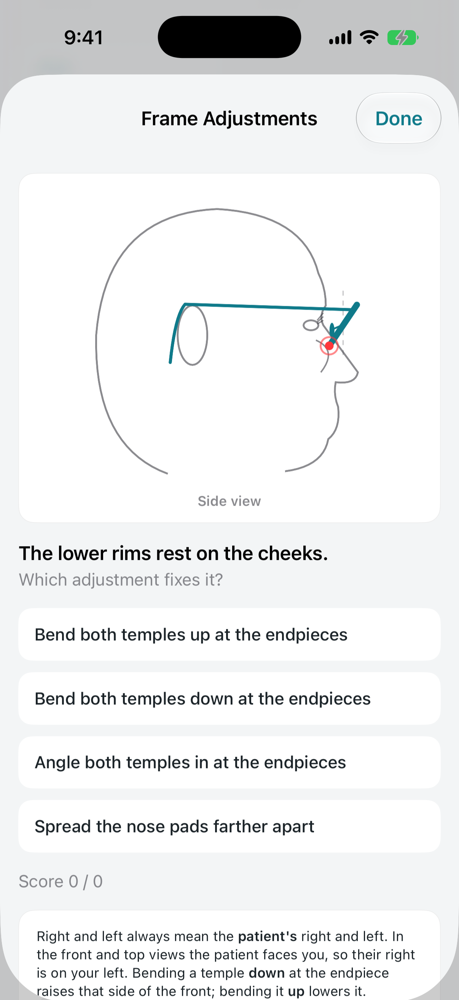

<p align="center">
  
</p>

<h1 align="center">petty: Optician</h1>

<p align="center"><strong>Study for the ABO and NCLE optician exams without paying for a prep course.</strong></p>

<p align="center">
  <a href="LICENSE"></a>
  
  
</p>

petty: Optician is a free, open source iPhone and iPad app for people preparing for the **ABO Basic** (spectacle) and **NCLE Basic** (contact lens) certification exams. Everything is organized by the official ABO-NCLE content outline, so you study the same sections the exam tests, weighted the same way. It also includes a guide to becoming a registered dispensing optician in California (SLD, CLD and RDO through the California State Board of Optometry).

Your progress stays on your device. No account, ads, analytics, paid subscriptions, or paid feature tiers.

**[Build the app](#build-and-run)** · **[Report a bug](https://github.com/petty-foss-dev/Petty-Optician/issues/new)**

## A look inside

Real screenshots from the iPhone simulator.

<table>
  <tr>
    <th>Know where you stand</th>
    <th>Study by official exam section</th>
    <th>Practice with your hands</th>
  </tr>
  <tr>
    <td></td>
    <td></td>
    <td></td>
  </tr>
  <tr>
    <th>Work out prism and base direction</th>
    <th>Fix a frame that fits wrong</th>
    <th></th>
  </tr>
  <tr>
    <td></td>
    <td></td>
    <td></td>
  </tr>
</table>

## What's inside

- **1,193 practice questions** (684 ABO, 509 NCLE), each with an explanation, tagged by official section and topic. Quizzes can be built by section, difficulty, unseen, missed, or flagged.
- **Mock exams in the real format:** 125 questions in 120 minutes, weighted by the content outline, with 25 unscored pretest items mixed in, no topic hints, an on-screen scientific calculator, and a review screen before you submit.
- **Hands-on trainers:**
  - ABO: lensometer, frame adjusting, PD and seg height measuring, prism and base direction, ANSI Z80.1-2025 job checks
  - NCLE: keratometer, GP fluorescein patterns, soft lens fit with a push-up test, toric rotation (LARS)
- **Unlimited math drills** for Prentice's rule, transposition, vertex, blank size, keratometry, tear lens and more, with worked solutions.
- **640 spaced-repetition flashcards**, a 465-term glossary, 19 reference tables, and a formula sheet.
- **Study guides** for every official section, with 13 original diagrams and 43 openly licensed photos.
- **681 free outside resources**, including 340 videos and playlists that play inside the app.
- **Calculators** for spectacle and contact lens formulas, and a weak-topic report that shows what to drill next.
- **Exam countdown, daily study plan and reminders.**

Practice questions are original. They are not taken from the real exams.

## Build and run

You need Xcode 26 or later and [XcodeGen](https://github.com/yonaskolb/XcodeGen).

```bash
xcodegen generate
open PettyOptician.xcodeproj
```

Run the `PettyOptician` scheme on an iPhone or iPad simulator running iOS 17 or later. To build and test from the command line:

```bash
xcodebuild -project PettyOptician.xcodeproj -scheme PettyOptician \
  -destination "platform=iOS Simulator,name=iPhone 17" test
```

All study content is JSON in `PettyOptician/Resources/Content/`. Drop in a new `questions_*.json`, `flashcards_*.json`, `guides_*.json` or `resources_*.json` file and it loads with no code changes. `ContentTests` checks every file, so run the tests after adding content. The file formats are described in [CLAUDE.md](CLAUDE.md).

## Contribute

Found a wrong answer, an outdated rule, or a dead link? [Open an issue](https://github.com/petty-foss-dev/Petty-Optician/issues/new) with the question or resource and a source. Corrections backed by a reliable source are the most useful contribution.

## Not affiliated

petty: Optician is an independent study aid. It is not affiliated with or endorsed by the American Board of Opticianry, the National Contact Lens Examiners, or the California State Board of Optometry. Check exam fees and registration rules with them before you apply.

## License

The app's source code and original content are licensed under [AGPL-3.0-only](LICENSE).

The photos in `PettyOptician/Resources/Images/` come from Wikimedia Commons under their own licenses (CC BY, CC BY-SA, CC0 or public domain). Each photo's author, license and source are listed in `PettyOptician/Resources/Content/images.json` and inside the app under Settings → Image Credits.
